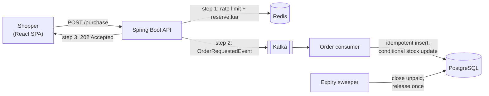
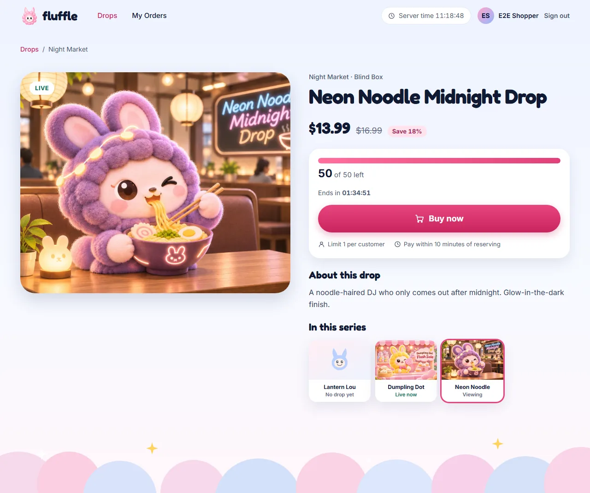
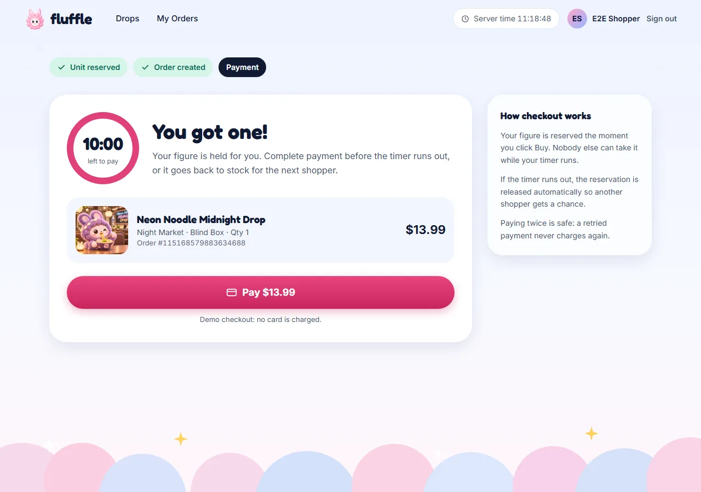
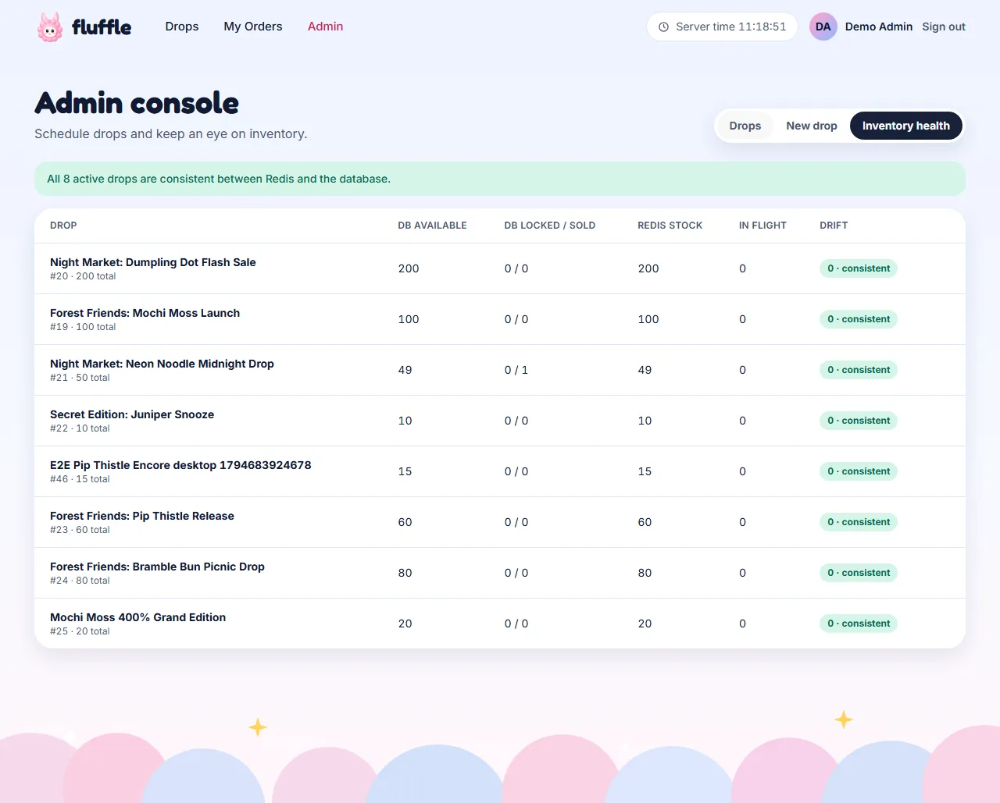
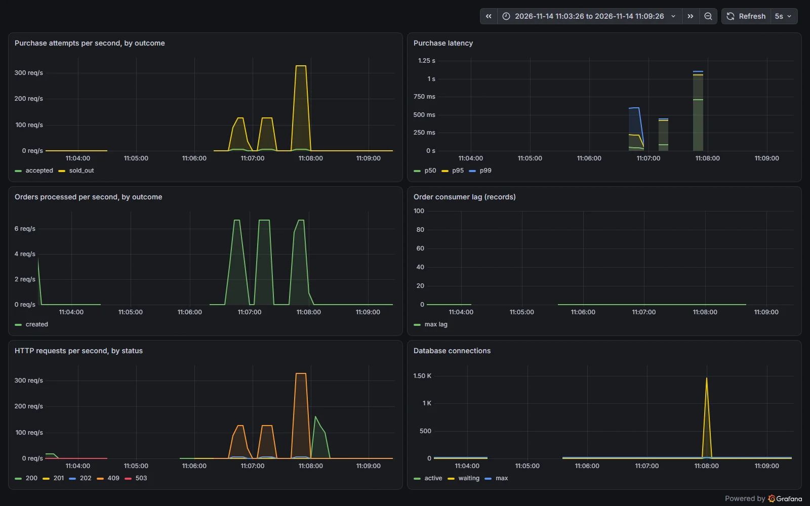

# Flash Sale System

[](https://github.com/leileili1010/flash-sale-system/actions/workflows/ci.yml)

A full-stack, high-concurrency shop for limited-edition designer collectibles. Products go on
sale in **drops**: a fixed number of units, released at a scheduled instant, one per customer.
When thousands of shoppers press **Buy** in the same second, the system stays responsive, sells
every unit exactly once, and **never oversells**.


## Highlights

- **No overselling, measured.** In k6 load tests, 2,000 and 5,000 shoppers raced for 100 units;
  every run produced exactly 100 orders. The naive read-then-write approach it replaced accepted
  2,000 purchases for the same 100 units. See [performance](docs/performance.md).
- **Atomic reservation in Redis.** A single Lua script checks the release window, the
  one-per-customer limit and the stock, then reserves the unit. Only winners go further.
- **Asynchronous orders on Kafka.** The purchase request touches only Redis and Kafka. An
  idempotent consumer persists orders, with retries and a dead-letter topic.
- **Invariants in the database.** `CHECK` constraints keep `available + locked + sold = total`,
  and a partial unique index allows one live order per customer, whatever the application does.
- **Exactly-once stock release.** Unpaid orders expire after 10 minutes and return their unit
  exactly once, even when a late payment races the expiry job.
- **Production concerns covered.** Two-tier rate limiting, stateless JWT auth, RFC 9457 errors,
  Prometheus metrics with a Grafana dashboard, and an admin console with inventory reconciliation.
- **Tested end to end.** Unit and Testcontainers integration tests against real PostgreSQL,
  Redis and Kafka; Playwright browser tests; k6 load tests; GitHub Actions CI.

## How it works



1. Redis decides each purchase atomically, so the request path never waits on the database.
2. Winners publish an order event to Kafka; everyone else gets an immediate `409 SOLD_OUT`.
3. A consumer writes the order to PostgreSQL, where constraints make duplicates and oversells
   impossible. The shopper pays within 10 minutes, or the unit goes back on sale.

The full design, guarantees and failure handling are in [`docs/architecture.md`](docs/architecture.md).

<table>
  <tr>
    <td></td>
    <td></td>
  </tr>
  <tr>
    <td></td>
    <td></td>
  </tr>
</table>

## Quick start

Requirements: Docker, JDK 25 and Node.js 24.

```sh
# 1. Infrastructure: PostgreSQL, Redis, Kafka (and Kafka UI on :8085)
docker compose -f infra/docker-compose.yml up -d --wait

# 2. Backend on :8080 (applies migrations and seeds demo data)
cd backend && ./mvnw spring-boot:run

# 3. Frontend on :5173 (in another terminal)
cd frontend && npm install && npm run dev
```

Open http://localhost:5173 and sign in with a demo account:

| Role    | Email                 | Password           |
|---------|-----------------------|--------------------|
| Shopper | `shopper@fluffle.dev` | `shopper-password` |
| Admin   | `admin@fluffle.dev`   | `admin-password`   |

A rolling demo schedule always has drops that are live, about to start, and later. Signing in as
the admin adds an **Admin** link for scheduling drops and checking inventory health.

To run the backend in Docker as well, with Prometheus and Grafana (http://localhost:3000):

```sh
docker compose -f infra/docker-compose.yml --profile app --profile monitoring up -d --build --wait
```

## Tech stack

| Layer          | Technology                                                    |
|----------------|---------------------------------------------------------------|
| Frontend       | React 19, TypeScript, Vite, Tailwind CSS, TanStack Query, React Router |
| Backend        | Java 25 (virtual threads), Spring Boot 4.1, Spring Security (JWT) |
| Data           | PostgreSQL 18, Flyway, Spring Data JPA                        |
| Stock & cache  | Redis 8 (Lua scripts, read-through cache)                     |
| Messaging      | Apache Kafka 4.1 (KRaft)                                      |
| Rate limiting  | Bucket4j (in memory + Redis)                                  |
| Observability  | Spring Boot Actuator, Micrometer, Prometheus, Grafana         |
| Testing        | JUnit 5, Testcontainers, Vitest, Testing Library, Playwright, k6 |
| Delivery       | Docker, Docker Compose, GitHub Actions                        |

## Repository layout

```
backend/      Spring Boot service (Dockerfile, Flyway migrations, Lua scripts, tests)
frontend/     React + TypeScript app (unit tests, Playwright end-to-end tests)
infra/        Docker Compose stack, Prometheus and Grafana provisioning
load-tests/   k6 spike scenarios and runner
docs/         Architecture, performance report, decision records, screenshots
```

## Documentation

- [Architecture](docs/architecture.md): components, the purchase path, order lifecycle, stock
  accounting, guarantees, failure handling, and changes from the reference project
- [Performance](docs/performance.md): load-test method, results, findings, and next steps
- [Decision records](docs/adr/README.md): why PostgreSQL, Redis Lua, Kafka, a database sweep,
  two-tier rate limiting, JWT, a React SPA, and Linux-based load testing
- [Load tests](load-tests/README.md): how to run the k6 scenarios

## Testing

```sh
cd backend && ./mvnw verify      # 88 unit and integration tests (Testcontainers needs Docker)
cd frontend && npm test          # 44 component and page tests
cd frontend && npm run e2e       # Playwright, desktop and mobile (needs the stack running)
./load-tests/run.sh spike 2000 100   # k6 (see load-tests/README.md)
```

Integration tests run against real PostgreSQL, Redis and Kafka containers. They include 2,000
concurrent shoppers against 100 units, redelivered Kafka events, a payment-versus-expiry race,
and a complete drop over HTTP. CI runs the backend and frontend suites on every pull request.

<details>
<summary><strong>API reference</strong></summary>

| Endpoint | Description |
|---|---|
| `GET /api/products`, `GET /api/products/{id}` | Product catalog (Redis-cached) |
| `GET /api/drops?phase=LIVE\|UPCOMING\|ENDED` | Published drops |
| `GET /api/drops/{id}` | Drop details with live phase and stock |
| `GET /api/time` | Server time, used to synchronise countdowns |
| `POST /api/auth/register`, `POST /api/auth/login` | Create an account or sign in; returns a JWT |
| `GET /api/auth/me` | Current user |
| `POST /api/drops/{id}/purchase` | Reserve a unit; `202` with an order number to poll |
| `GET /api/orders/{orderNo}`, `GET /api/orders` | Order status (`QUEUED`, `PENDING_PAYMENT`, `PAID`, `CLOSED`, `FAILED`) and history |
| `POST /api/orders/{orderNo}/pay` | Simulated checkout; idempotent |
| `GET /api/admin/drops`, `POST /api/admin/drops` | Admin: list drops in any status; create as draft or published |
| `POST /api/admin/drops/{id}/publish`, `.../cancel` | Admin: publish a draft; cancel before start |
| `GET /api/admin/inventory`, `POST /api/admin/inventory/{id}/resync` | Admin: Redis vs. database stock, drift, resync |
| `GET /actuator/health`, `GET /actuator/prometheus` | Health probes; metrics |

Catalog reads are public; purchases, orders and payments need a bearer token; `/api/admin/**`
needs the `ADMIN` role. Errors are [RFC 9457](https://www.rfc-editor.org/rfc/rfc9457) problem
details with a stable `code` (for example `SOLD_OUT`, `ALREADY_PURCHASED`, `RATE_LIMITED`).

</details>

<details>
<summary><strong>Configuration</strong></summary>

The backend reads environment variables with local defaults:

| Variable | Default | Purpose |
|---|---|---|
| `DB_HOST`, `DB_PORT`, `DB_NAME`, `DB_USER`, `DB_PASSWORD` | `localhost`, `5433`, `flashsale` | PostgreSQL |
| `REDIS_HOST`, `REDIS_PORT` | `localhost`, `6379` | Redis |
| `KAFKA_BOOTSTRAP_SERVERS` | `localhost:9092` | Kafka |
| `JWT_SECRET`, `JWT_TTL` | dev-only secret, `2h` | Token signing (Base64, at least 32 bytes) and lifetime |
| `WORKER_ID` | `1` | Unique per instance (0–1023), for Snowflake order numbers |
| `ORDER_PAYMENT_WINDOW` | `10m` | Time to pay before the unit is released |
| `ORDER_EXPIRY_SWEEP_INTERVAL` | `5s` | How often expired orders are closed |
| `RATE_LIMIT_GLOBAL_PER_SECOND` | `5000` | Purchase attempts per second, per instance |
| `RATE_LIMIT_USER_CAPACITY`, `RATE_LIMIT_USER_PERIOD` | `5`, `10s` | Purchase attempts per customer |
| `SERVER_ACCEPT_COUNT` | `10000` | Tomcat connection backlog for bursts |
| `CORS_ALLOWED_ORIGINS` | `http://localhost:5173` | Allowed browser origins |
| `DEMO_SEED_USERS`, `DEMO_SEED_DROPS` | `true` | Demo accounts and rolling demo schedule |

Infrastructure ports can be changed by copying `infra/.env.example` to `infra/.env`. PostgreSQL
uses 5433 on the host to avoid clashing with a local server. Product artwork lives in
`frontend/public/images/products/`; products without artwork show a drawn placeholder.

</details>

## License

Licensed under the [Apache License 2.0](LICENSE). The flash-sale design (Redis pre-deduction,
asynchronous order creation, payment-timeout release) is adapted from an earlier project; see
[NOTICE](NOTICE).
