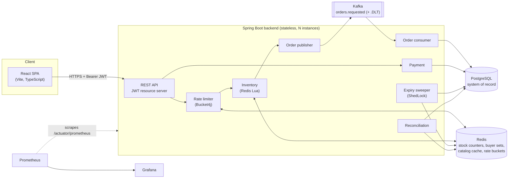
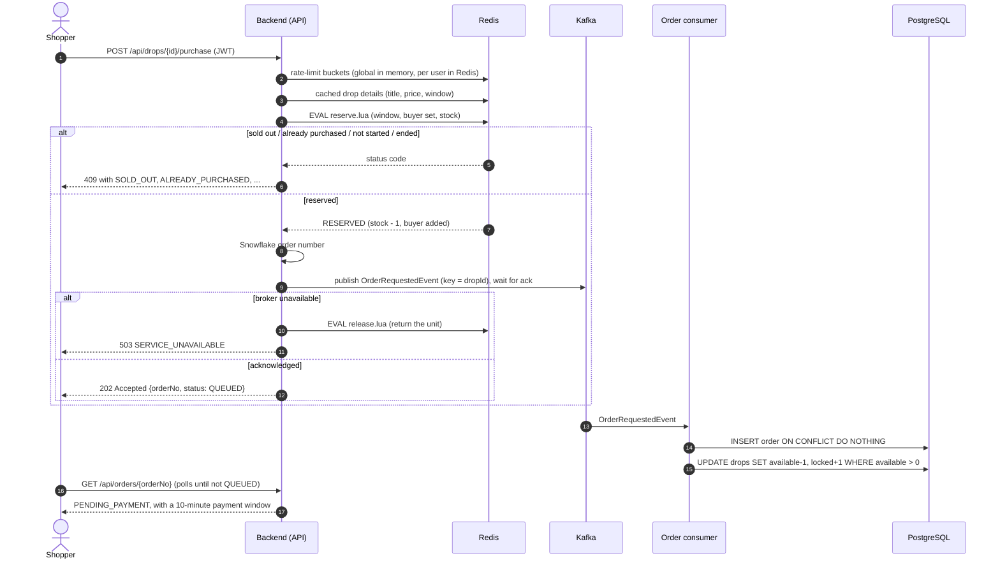
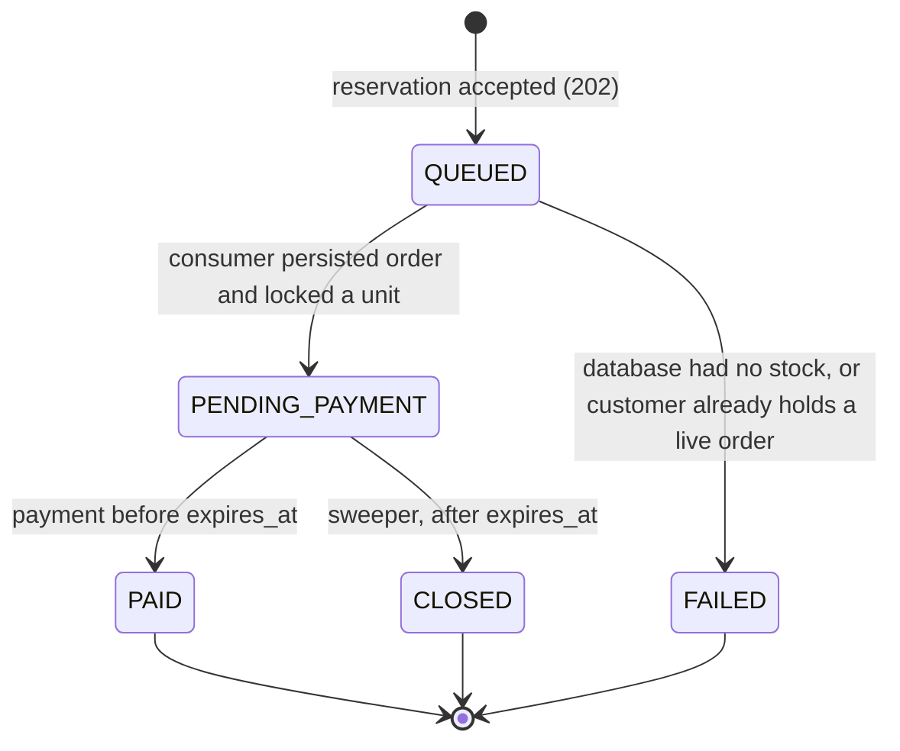
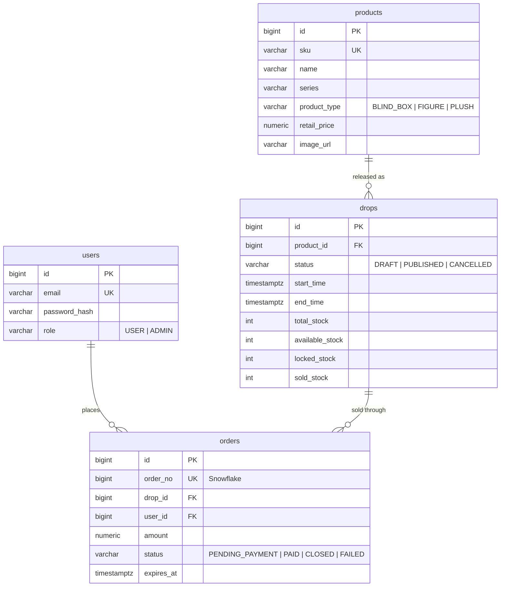

# Architecture

Flash Sale System sells limited-edition collectibles in **drops**: a fixed number of units that
go on sale at a scheduled instant, one per customer. The defining workload is a spike: thousands
of shoppers press **Buy** in the same second for, say, 100 units. The system must stay
responsive, sell every unit exactly once, and never oversell.

This document explains how the pieces fit together, the guarantees they provide, and why the
design looks the way it does. Individual decisions are recorded in [`adr/`](adr/).

- [System overview](#system-overview)
- [The purchase path](#the-purchase-path)
- [Order lifecycle](#order-lifecycle)
- [Stock accounting](#stock-accounting)
- [Correctness guarantees](#correctness-guarantees)
- [Failure handling](#failure-handling)
- [Data model](#data-model)
- [Security](#security)
- [Observability](#observability)
- [Backend modules](#backend-modules)
- [Frontend](#frontend)
- [Changes from the reference project](#changes-from-the-reference-project)
- [Scaling out](#scaling-out)

## System overview



| Component | Role | Why it is there |
|---|---|---|
| **Redis** | Live stock counter, buyer set and release window per drop; catalog cache; per-user rate-limit buckets | Absorbs the spike. A Lua script decides each purchase atomically in microseconds, so only winners proceed. |
| **Kafka** | Carries `OrderRequestedEvent`s from the API to the order consumer | Decouples the request path from database writes, so purchase latency does not depend on database load. Durable, retryable, replayable. |
| **PostgreSQL** | Orders, drops, products, users | The system of record. Constraints make overselling and duplicate live orders impossible regardless of application bugs. |
| **Backend** | Stateless Spring Boot service | Any instance can serve any request; state lives in Redis, Kafka and PostgreSQL. |
| **Prometheus + Grafana** | Metrics and dashboards | Shows purchase outcomes, latency percentiles, consumer lag and connection-pool pressure during a drop. |

## The purchase path

The request path touches **only Redis and Kafka**. The database is written asynchronously, at a
rate bounded by the stock, not by the traffic.



**`reserve.lua`** does, as one atomic step: check the drop is loaded, check the release window
against the server time passed in, reject customers already in the buyer set, reject when stock
is zero, then decrement stock and add the buyer. Redis runs scripts without interleaving other
commands, so two requests can never both take the last unit, and a customer cannot slip a second
reservation in between the check and the write.

**Ordering by drop.** Events are keyed by drop id, so one drop's orders land on one partition and
are applied by one consumer at a time. The drop's stock row is never contended by parallel
consumers, and throughput per drop is bounded by its stock, which Redis has already enforced.

## Order lifecycle



`QUEUED` exists only between the `202` response and the consumer persisting the order (typically
milliseconds); a short-lived Redis marker lets the owner poll it. Every transition out of
`PENDING_PAYMENT` is a compare-and-set on the status, so a late payment and the expiry sweeper
can never both win.

## Stock accounting

Each drop's units are always in exactly one bucket, and a database `CHECK` enforces it:

```
available_stock + locked_stock + sold_stock = total_stock     (all >= 0)
```

| Event | available | locked | sold | Redis counter |
|---|---|---|---|---|
| Reservation in Redis | – | – | – | −1 (buyer added) |
| Consumer persists the order | −1 | +1 | – | – |
| Payment | – | −1 | +1 | – |
| Expiry (sweeper) | +1 | −1 | – | +1 (buyer removed) |
| Consumer finds no database stock | – | – | – | buyer removed only |

Redis runs ahead of the database by the **in-flight reservations** (events still in Kafka). In a
consistent system, `redis stock = database available - in flight`. The reconciliation job reports
any difference as drift, and the admin console shows it; resynchronising is a deliberate admin
action, never automatic.

## Correctness guarantees

| Guarantee | Enforced by |
|---|---|
| **Never oversell** | `reserve.lua` (first gate) and the conditional `UPDATE ... WHERE available_stock > 0` plus the stock `CHECK` constraints (last line of defence) |
| **One live order per customer per drop** | Buyer set in `reserve.lua`, and the partial unique index `orders (drop_id, user_id) WHERE status IN ('PENDING_PAYMENT', 'PAID')` |
| **A redelivered event creates no duplicate** | Order number assigned before publishing; `INSERT ... ON CONFLICT DO NOTHING` on `order_no` |
| **A unit is released exactly once** | Sweeper closes only rows it moves from `PENDING_PAYMENT` (`UPDATE ... RETURNING`); `release.lua` increments only if it removed the buyer |
| **Payment and expiry never both succeed** | Both are compare-and-set updates on `status` (and on `expires_at` for payment) |
| **A failed publish loses no stock** | The reservation is released and the client gets `503` |
| **Cancelled drops cannot be bought** | Cancel commits, then unloads the Redis keys and evicts the cached details |

These are verified by tests that run against real PostgreSQL, Redis and Kafka (Testcontainers),
including 2,000 concurrent shoppers against 100 units, a payment-versus-expiry race, redelivered
events, and a full drop over HTTP with 400 shoppers. Load-test results are in
[`performance.md`](performance.md).

## Failure handling

| Failure | Behaviour |
|---|---|
| Kafka unavailable at purchase time | Producer fails within 2 s (`max.block.ms`); the reservation is released; `503` |
| Consumer crashes mid-event | Offsets commit per record after processing, so the event is redelivered; idempotent insert makes it harmless |
| Malformed or repeatedly failing event | Three retries, then `orders.requested.DLT` with the original bytes; the partition keeps moving |
| Redis loses data mid-drop | Preheat reloads stock with `SET NX` and restores buyers of live orders from PostgreSQL; the database constraints still prevent overselling, so some reservations may end as `FAILED` orders |
| Redis correction fails after a database commit | The database is already correct; reconciliation reports the drift |
| Two backend instances run the sweeper | ShedLock runs it on one at a time; the conditional SQL would stay correct anyway |
| Shopper's clock is wrong | Countdowns use the server clock (offset measured from `/api/time`), and the server checks the window itself |
| Traffic beyond capacity | Per-instance global token bucket sheds load with `429` and `Retry-After`; per-user buckets stop scripted hammering |

## Data model



Notable indexes: the partial unique index above; a partial index on `orders (expires_at) WHERE
status = 'PENDING_PAYMENT'` that keeps the sweeper's scan tiny; `drops` uses `fillfactor = 80` so
frequent stock updates stay HOT updates. The schema is managed by Flyway (`backend/src/main/resources/db/migration`).

Redis keys per drop share a hash tag so the multi-key Lua scripts stay valid on Redis Cluster:
`drop:{42}:stock`, `drop:{42}:buyers`, `drop:{42}:meta` (window). They expire one day after the
drop ends.

## Security

- **Stateless JWT** (HS256), issued by the backend and validated as an OAuth2 resource server;
  issuer and expiry are checked on every request. No server-side sessions.
- The caller's identity always comes from the validated token subject (`@AuthenticatedUser`),
  never from the request path or body.
- Roles: `USER`, `ADMIN`. Catalog reads are public; purchases, orders and payments require a
  token; `/api/admin/**` requires `ADMIN`.
- BCrypt password hashes; login spends equal hashing time for unknown emails so responses do not
  reveal which accounts exist.
- Other customers' orders return `404`, not `403`, so order numbers cannot be probed.
- Errors are RFC 9457 problem details with a stable `code`; unexpected exceptions never leak
  internals.
- The `benchmark` profile adds unauthenticated load-testing helpers and must never be enabled in
  a shared environment.

## Observability

Spring Boot Actuator with Micrometer, scraped by Prometheus and shown on the provisioned
**Flash Sale** Grafana dashboard (`docker compose --profile monitoring up`):

- `flashsale_purchase_attempts_total{outcome}`: accepted, sold_out, already_purchased, rate_limited, ...
- `flashsale_orders_processed_total{outcome}`: created, duplicate_event, sold_out, customer_has_live_order
- `http_server_requests_seconds` histograms: p50/p95/p99 purchase latency
- Kafka client metrics, including consumer lag
- HikariCP active and waiting connections, JVM heap and threads

## Backend modules

| Package | Responsibility |
|---|---|
| `catalog` | Products and drops, public read API, Redis read-through cache (`CatalogCache`) |
| `inventory` | Lua reservation and release, preheating, reconciliation, admin inventory endpoints |
| `ratelimit` | Global (in memory) and per-user (Redis) token buckets |
| `order` | Purchase service, Kafka wiring, order consumer, order queries |
| `payment` | Simulated payment, expiry service and sweeper |
| `auth`, `user` | JWT issuing and validation, accounts, security configuration |
| `admin` | Drop scheduling: create, publish, cancel |
| `demo` | Local demo data (accounts, a rolling drop schedule) |
| `benchmark` | Load-testing helpers, `benchmark` profile only |
| `common` | Error model, Snowflake ids, server time |

## Frontend

A React 19 + TypeScript single-page app (Vite, Tailwind CSS, TanStack Query, React Router):

- A typed API client that maps problem responses to error codes, so each screen reacts to
  `SOLD_OUT`, `ALREADY_PURCHASED`, `RATE_LIMITED` (with `Retry-After`) and so on.
- A server-clock provider: countdowns finish exactly when the backend opens a drop.
- The buy button derives exactly one state from the drop, the server clock and the last attempt.
- Checkout polls while the order is `QUEUED`, then shows the payment window.
- An admin console for scheduling drops and checking inventory health.

## Changes from the reference project

The architecture follows an existing tutorial project (Redis pre-deduction, asynchronous order
creation, payment timeout), modernised and corrected:

| Area | Reference project | This project |
|---|---|---|
| Runtime | Java 8, Spring Boot 2.3 | Java 25 (virtual threads), Spring Boot 4.1 |
| Messaging | RocketMQ, including delayed messages | Kafka with idempotent producer and dead-letter topic; delays replaced by an indexed database sweep |
| Database | MySQL, MyBatis generator, no schema file | PostgreSQL, Flyway migrations, constraints that enforce the invariants |
| Rate limiting | Sentinel | Bucket4j: per-instance global plus distributed per-user |
| Views | Thymeleaf with static page generation | React SPA plus REST, Redis-cached catalog |
| Auth | User id in the URL | JWT; identity from the token |
| JSON | fastjson (known CVEs) | Jackson |
| Per-customer limit | Check commented out; buyer registered only after async order creation | Checked and registered atomically in the reservation script, backed by a unique index |
| Timeout release | Restocked any unpaid order, including failed ones that never held stock (stock inflation); not idempotent | Releases only orders it closes, exactly once |
| Payment vs timeout | No compare-and-set; both could succeed | Compare-and-set on status |
| Publish failure | Redis unit lost | Reservation released |
| Startup preheat | Overwrote live counters from the database | `SET NX`; buyers restored |
| Tests | Two `println` tests | Unit, Testcontainers integration, Playwright end-to-end, k6 load tests, CI |

## Scaling out

The backend is stateless, so it scales horizontally behind a load balancer:

- **Rate limiting** keeps a per-instance global bucket (no shared hot key) and a shared per-user
  bucket in Redis.
- **Redis** keys are hash-tagged per drop, so the scripts work on Redis Cluster and different drops
  spread across shards. A single drop stays on one shard; its stock check is a few microseconds of
  Lua.
- **Kafka** spreads drops across partitions; add consumer instances up to the partition count.
- **PostgreSQL** sees roughly one write per unit sold, independent of traffic.
- **Order numbers** need a unique `WORKER_ID` per instance (Snowflake).
- Scheduled jobs (sweeper, reconciliation) are coordinated with ShedLock.

Capacity measurements and their limits are discussed in [`performance.md`](performance.md).
