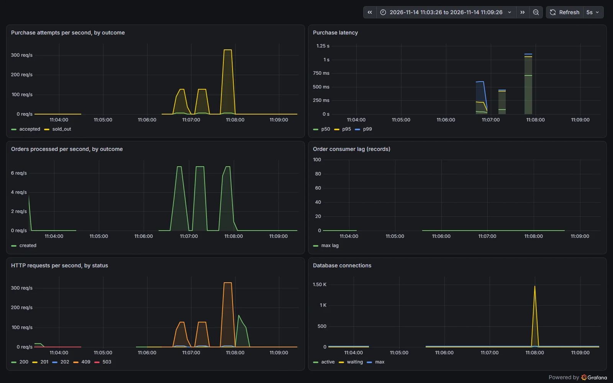

# Performance and correctness under load

The question a flash-sale system has to answer is not "how fast is it on a quiet day?" but
"what happens when thousands of people press Buy at the same second for 100 units?" This report
measures exactly that, compares it with the naive approach the project replaced, and records
what the load tests revealed and fixed.

**Summary**

- **No overselling in any run.** 2,000 and 5,000 shoppers raced for 100 units; every run produced
  exactly 100 orders, and every other request received a clean `409 SOLD_OUT`.
- **The naive read-then-write approach oversold 20×**: 2,000 purchases accepted for 100 units.
- **Every request was answered**: zero connection errors once the backend ran inside Linux.
- The whole burst was served in **1.3–1.8 s for 2,000 shoppers** and **2.7 s for 5,000 shoppers**
  on a single laptop that also ran the load generator and every dependency.

## Setup

| | |
|---|---|
| Machine | Laptop, Intel Core i7-1360P (16 logical CPUs), 16 GB RAM for the Docker VM |
| Topology | Everything in one Docker Desktop VM: backend (1 instance), PostgreSQL 18, Redis 8, Kafka 4.1, Prometheus, Grafana, **and the k6 load generator** |
| Backend | Java 25 (virtual threads), Spring Boot 4.1, container built from `backend/Dockerfile`, `net.core.somaxconn=8192`, default rate limits (5,000 req/s global per instance; 5 per user per 10 s) |
| Load generator | k6 1.8.2 in a container on the same Docker network, calling `http://backend:8080` |
| Scenarios | [`load-tests/spike.js`](../load-tests/spike.js), [`load-tests/naive.js`](../load-tests/naive.js) |

### Method

Each scenario creates its own drop and, before it opens, mints one JWT per virtual user. Every
virtual user then sleeps until the drop's start time and sends a single purchase, so the entire
population arrives in the same instant. That is a harsher test than real traffic, which arrives
over a few seconds.

After the burst, the spike scenario waits for Kafka to drain and checks the database: the number
of orders must equal the stock exactly (`locked + sold = 100`) and nothing may be oversold. Each
run starts on a JVM warmed by one discarded 500-shopper run.

## Results

| Scenario | Shoppers | Stock | Accepted | Sold out | Connection errors | Orders in DB | Oversold | p50 | p95 | p99 | max |
|---|---|---|---|---|---|---|---|---|---|---|---|
| Real design, run 1 | 2,000 | 100 | **100** | 1,900 | 0 | **100** | **0** | 984 ms | 1.70 s | 1.75 s | 1.77 s |
| Real design, run 2 | 2,000 | 100 | **100** | 1,900 | 0 | **100** | **0** | 566 ms | 1.19 s | 1.25 s | 1.29 s |
| Real design | 5,000 | 100 | **100** | 4,900 | 0 | **100** | **0** | 1.51 s | 2.29 s | 2.48 s | 2.71 s |
| Naive read-then-write | 2,000 | 100 | **2,000** | 0 | 0 | n/a | **1,900** | 3.07 s | 4.65 s | 4.89 s | 4.99 s |

Latency is measured by k6 from request start to response, for the purchase request only.
Because every request arrives together, the maximum is effectively the time to serve the whole
burst: about **1,100–1,550 purchase requests per second** for 2,000 shoppers and **1,850 per
second** for 5,000.



*The Flash Sale dashboard across these runs: purchase outcomes, latency percentiles, orders
processed, HTTP status codes and database connections. The spike in waiting database connections
at the end is the naive endpoint, which queries the database on every request; the real design's
purchase path never touches it.*

## Interpretation

**Correctness is independent of load.** Whether 200, 2,000 or 5,000 shoppers raced, the number of
orders equalled the stock exactly. The Lua script makes each reservation one indivisible step, so
there is no window in which two requests can take the same unit. The database's conditional update
and `CHECK` constraints would stop an oversell even if Redis got it wrong.

**Why the naive endpoint oversells.** It reads the stock, checks it in Java, then writes back
`stock - 1`. Under concurrency, hundreds of requests read the same value before any write lands,
all pass the check, and each writes the same "new" value. In this run, every one of the 2,000
requests was accepted for 100 units. It is also the slowest option: every request holds a database
connection, so requests queue for the 20-connection pool (about 1,500 waiting at peak).

**Where the time goes.** A single purchase on an idle system takes about 10–25 ms. Under the burst,
requests queue for CPU and network:

- The load generator runs 2,000–5,000 virtual users on the same 16 CPUs as the backend, PostgreSQL,
  Redis and Kafka, so the measurement competes with itself.
- Each purchase makes several Redis round trips (per-user rate-limit bucket, cached drop details,
  the reservation script) before responding. Winners also wait for Kafka to acknowledge.
- JWT verification and JSON serialisation are CPU work multiplied by the whole burst.

These numbers are a lower bound for the design on modest hardware, not a capacity claim. A
production deployment would run several backend instances on dedicated hosts behind a load
balancer, with the load generator elsewhere.

## What load testing found and fixed

Running at this scale exposed problems that unit and integration tests could not:

1. **Tomcat's connection backlog was 100.** When thousands of connections arrive in the same
   millisecond, the operating system refuses everything beyond the backlog before the application
   sees it. A 5,000-shopper run lost about 1,390 requests this way. Raising `server.tomcat.accept-count`
   to 10,000 (configurable) cut that to 40 when testing from the host.

2. **The host OS was the bottleneck, not the application.** Running from the Windows host, the
   same 2,000-shopper test produced anywhere from 0 to 1,683 refused connections, because Windows
   caps a socket's listen backlog at about 200 and Docker Desktop's port proxy adds its own limits.
   Moving the backend into a Linux container with `net.core.somaxconn=8192`, and the load generator
   onto the same Docker network, eliminated connection errors entirely. This is why the project now
   ships a backend Dockerfile and a Compose `app` profile.

3. **Cache stampede when a drop opens.** The first request for a new drop loads its details from
   the database into Redis. When thousands arrive together, every one of them missed the cache and
   queried the database. `@Cacheable(sync = true)` now makes concurrent misses wait for a single
   load per key on each instance.

4. **Cold start matters.** The first burst after the backend started was about 10× slower (median
   about 1.1 s versus 107 ms for a 200-shopper burst served from the host) while the JIT compiled
   the hot path. In production, warm instances before a scheduled drop, for example with a
   synthetic request or by keeping instances running.

## Reproducing

```sh
SPRING_PROFILES_ACTIVE=benchmark docker compose -f infra/docker-compose.yml \
  --profile app --profile monitoring up -d --build --wait

./load-tests/run.sh spike 500 20     # warm-up, discard
./load-tests/run.sh spike 2000 100
./load-tests/run.sh spike 5000 100
./load-tests/run.sh naive 2000 100
```

Open http://localhost:3000 to watch the Grafana dashboard while the tests run. Full k6 output is
written to `load-tests/results/`. Expect some variation between runs; the correctness results
(orders = stock, nothing oversold) do not vary.

## Next steps

- **Collapse the per-user rate-limit check into the reservation script.** It would save a Redis
  round trip on the hottest path.
- **Benchmark horizontal scaling.** Run 2–4 backend instances behind a load balancer, with the load
  generator on a separate machine, to measure throughput per instance.
- **Profile the burst.** Profile the purchase path under load (async-profiler or JFR) to attribute
  time precisely between JWT verification, Redis round trips and serialisation.
- **Add a sustained-traffic scenario.** A steady arrival rate over several minutes would complement
  the single-instant spike.
